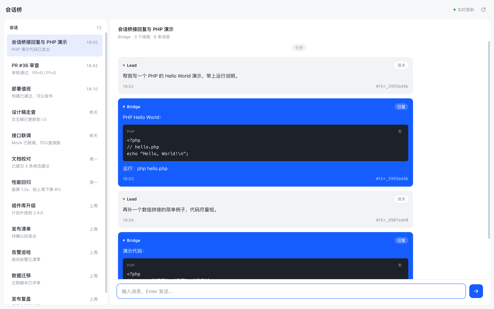
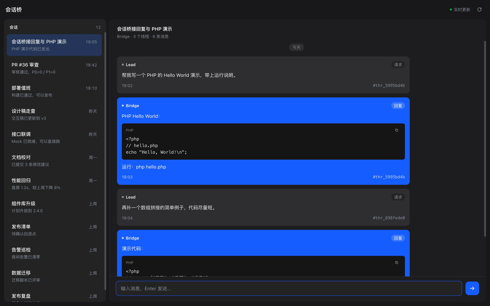

# 会话聊天（Session Chat）

[English](README.md) | 中文

让不同的独立 DSH 会话之间可以异步互发消息：可以按角色路由，也可以直接用 `@` 引用里的 session id 投递；消息落本地 SQLite，重启不丢；目标忙时排队、离线时等待、恢复后继续投递。

插件还提供一个「会话聊天」聊天面板：
- 会话视图行「轨迹」之后的标签页，绑定当前会话；
- 侧边栏全局「会话聊天」图标，打开独立面板，可在顶部选择身份会话。

面板跟随宿主浅色/深色主题，用来集中查看所有通过 bridge 沟通的会话。

## 界面预览

### 浅色主题



### 深色主题



> 截图由同一份独立 HTML 设计稿（[design/session-bridge-chat.html](design/session-bridge-chat.html)）用无头 Chrome 渲染，尺寸 2880×1800（CSS 1440×900 @2x），用于展示布局和配色；实际面板会跟随宿主主题，内容为示例数据。群组沿用同一套布局，截图暂以单聊为例，未单独展示成员胶囊、解散按钮和侧边栏入口；详见下方「截图信息」。

## 安装

1. 在 DSH 中打开 **Plugins**（插件）。
2. 选择 **Add plugin**，选中本仓库目录。
3. 插件行 `session-bridge` 启用后生效；需要 Full access。

首次启用会在 `~/.dsh/session-bridge/<profile>/bridge.db` 创建数据库（仅本人可读写）。

> 项目显示名是 **Session Chat / 会话聊天**；本地开发包名仍为 `dsh-session-bridge`，发布到 npm 时计划使用 `@janhuang/dsh-session-chat`（避免与现有 `dsh-session-chat` 冲突）。

## 快速开始

### 1. 绑定角色（可选）

如果使用角色路由，在每个独立会话里绑定一次：

```text
session_bind  { "role": "impl" }        # 或 reviewer、designer、deployer、lead
```

### 2. 发送消息

按角色发送：

```text
session_send  { "toRole": "reviewer", "kind": "request",
                "text": "请审查 PR #36，HEAD b572560",
                "threadId": "pr-36", "idempotencyKey": "review-pr-36-b572560" }
```

或者直接按 `@` 引用里的 session id 发送（目标无需绑定角色）：

```text
session_send  { "toSessionId": "session-2cb151f8-...",
                "text": "请跑一下导出并回报结果" }
```

### 3. 会话群组

把多个固定 session id 放进一个群组，然后一次群发：

```text
session_group_create { "name": "frontend",
                       "description": "前端协作群",
                       "members": ["session-a11933ef-...", "session-2cb151f8-..."] }

session_send { "toGroup": "frontend", "text": "请各位同步进度" }
```

群组发送会为每个其他成员各生成一条独立投递；某个成员失败不影响其他人。

成员用 `session_reply` 回复群消息时，**回复会广播给除自己以外的所有群成员**，形成群聊。

- 群成员是**固定 session id**，不随角色绑定变化
- 创建者始终在群里，且不能被移除；创建者或 lead 可以加人/移除别人
- 成员可以自己退出群组
- 当前会话不在群组时，群组不会出现在面板里，也不能群发

### 4. 读取与回复

目标会话收到后，用 `session_inbox` 查看，用 `session_reply` 回复：

```text
session_inbox  { "limit": 20, "markRead": true }
session_reply  { "messageId": "msg_...", "text": "已完成" }
```

### 5. 解散群组

创建者或 `lead` 可以解散群组：

```text
session_group_dissolve { "group": "frontend" }
```

- 所有成员被移出群组
- 群组不再出现在 `session_group_list` 和面板中
- 群消息保留在数据库，仍可按 group id 查询历史/审计

### 6. 同一回合内等待回复

希望当前回合内拿到对方回复时，用 `session_ask`：

```text
session_ask { "toSessionId": "session-2cb151f8-...", "text": "Ping" }
# -> reply from direct (messageId=msg_..., thread=...):
#
#    pong
```

`session_ask` 默认等待 90 秒；超时会返回提示，消息仍留在队列里，对方稍后的回复会作为新消息到达，不会丢。

## 使用聊天面板

打开会话视图行「轨迹」后面的 **会话聊天**：

### 左侧会话列表

- 同一对会话的所有线程合并成**一个会话项**，不按 thread 拆成多个
- 群组显示为带「群组」标签的会话项，标题是群名，副标题显示成员数；只有当前会话是成员时才显示
- 群聊头部展示**成员胶囊**：头像、标题/短 id、角色；当前会话标为「你」
- 点击其他成员胶囊会直接切换到与他的单聊；即使还没有直聊消息，也可以立即发第一条
- 创建者或 lead 可在群聊头部**解散群组**（二次确认）；解散后成员全部移除，群组从列表和面板消失，群消息保留在数据库中供历史/审计
- 列表超高时**独立滚动**，不跟随聊天内容；顶部「会话」标题固定
- 默认 / hover / 选中只用背景色区分，没有分割线和边框
- 简略内容超宽时，**鼠标 hover 才启动走马灯**，移开暂停并保留位置
- 当前会话相关的对话排在前面
- 群聊中当前会话发出的消息在右，其他成员在左；群回复显示为普通群消息

### 右侧聊天区

- **发送方在右、接收方在左**（以当前会话为视角）
- Lead 请求卡片使用中性底色；Bridge 回复卡片固定 `#165DFF` + 白字
- 每个卡片包含：发送方、请求/回复标签、正文、时间、`#线程ID`
- fenced PHP 代码会渲染成深色代码块，右上角有复制图标
- 正文中的链接和文件引用可点击：
  - `http(s)://...` 在浏览器打开
  - 绝对路径、反引号路径、Markdown 文件链接会通过 Host 的默认应用打开
  - 相对路径按**发送方会话的 cwd** 解析
- **默认只显示今天**；消息区滚动到顶部，或点击顶部「上拉加载更早消息」条，每次加载 **20 条**历史
- 新消息通过 SSE 实时追加，不做定时轮询；断线自动重连
- 聊天头部和底部输入栏固定，不随消息滚动
- 底部输入栏可向选中的对端排队发送请求；当前会话不在该对话中或对方未绑定时禁用

## 工具列表

| 工具 | 用途 |
|---|---|
| `session_send` | 按角色、`@` session id 或 `toGroup` 群组排队发送 request / reply / notice / control |
| `session_group_create` | 创建群组，成员为固定 session id；创建者自动加入 |
| `session_group_list` | 查看自己所在的群组、成员及其当前角色；lead 可看全部 |
| `session_group_add` | 创建者或 lead 向群组添加成员 |
| `session_group_remove` | 成员退群，或创建者/lead 移除他人；创建者不可移除 |
| `session_group_dissolve` | 创建者或 lead 解散群组；成员全部移除，群消息保留 |
| `session_ask` | 发送请求并在本回合内等待回复（默认 90 秒，超时回退异步） |
| `session_inbox` | 读取投递到本会话的消息，默认标记已读 |
| `session_reply` | 回复收到的消息，路由回原发送方并标记 acked |
| `session_status` | 查看投递状态、尝试次数、等待原因和时间戳；lead 可查看任意消息 |
| `session_list` | 查看可见的独立会话、绑定角色、运行状态、cwd、标题 |
| `session_bind` | 把本会话绑定到角色（一个会话一个角色） |
| `session_roles` | 查看角色、绑定关系、发送权限、是否允许注入当前回合 |

调用方身份来自工具执行时的 Agent，**不接受参数里的 session id 作为发送方**；目标可以是角色或用户 `@` 引用中的 session id。

## 角色与权限

默认内置五个角色：

| 角色 | 可发送给 |
|---|---|
| `lead` | impl, reviewer, designer, deployer |
| `impl` | reviewer, deployer, lead |
| `reviewer` | impl, deployer, lead |
| `designer` | impl, reviewer, lead |
| `deployer` | impl, lead |

- 配置里的 `roles` 可以新增角色或覆盖 `canSendTo` / `allowSteer` / `sessionId`
- 配置 `sessionId` 会把角色固定到某个会话，禁止运行时 `session_bind` 覆盖
- 回复不检查 `canSendTo`：收到消息后的回复天然允许
- 直接 `@` 投递不检查 `canSendTo`，属于用户显式指定；可用 `security.allowDirectSessionTargets: false` 关闭
- 子会话（subagent）不能绑定或接收，这是 DSH Session 控制面的限制；请使用独立顶层会话

## 配置参考

所有字段可选，写在 profile 的 `cordis.patch.yml` 中 `session-bridge` 行：

```yaml
- id: session-bridge
  name: dsh-session-bridge
  config:
    storage:
      # 默认：~/.dsh/session-bridge/<DSH_PROFILE>/bridge.db
      # sqlitePath: ~/.dsh/session-bridge/desktop/bridge.db
      auditRetentionDays: 30
    delivery:
      defaultMode: queue          # queue | steer
      allowSteerRoles: [lead, deployer]
      maxAttempts: 5
      retryBaseMs: 2000
      retryMaxMs: 60000
      tickMs: 1000
      askTimeoutMs: 90000         # session_ask 等待时间，超时回退异步
      promptTimeoutMs: 60000
      pendingInputDelayMs: 30000  # 目标等待审批/提问时的重试间隔
      unboundRoleRetryMs: 30000   # 角色未绑定时的重试间隔
      notifySenderOnFailure: true
      clientTimeZone: Asia/Shanghai
    limits:
      maxContentChars: 8000
      maxMetadataChars: 4000
      maxPendingPerSession: 50
      messageTtlMs: 86400000
      rateLimitPerMinute: 30
      maxInboxItems: 100
      maxGroups: 50                 # 每个 profile 的群组上限
      maxGroupMembers: 20           # 单个群组的成员上限
    security:
      allowDirectSessionTargets: true  # 是否接受 @ 引用的 session id
    roles:
      impl: { sessionId: session-..., canSendTo: [reviewer, deployer] }
```

## 投递语义

```text
send -> pending -> delivering -> delivered -> read -> acked
                        |            |
                        +-> pending（退避重试）
                        +-> failed（not-found / 子会话 / 次数耗尽）
pending -> expired（TTL 到期）
```

- `session/not-found`、目标是子会话：终态失败，并给发送方发一条系统通知
- `agent-busy`、`writer-held`、内部错误、超时：指数退避重试
- 目标有审批/提问待处理：不投递，延迟后重试，不消耗尝试次数
- 高优先级且发送方角色允许 steer 时注入当前回合，否则排队
- 目标角色未绑定时保持 pending，绑定后自动投递
- 投递 requestId 等于 messageId，目标 Agent 去重，不会重复处理

## 安全与限制

- 仅限单台机器、单个 DSH Host/profile，不做跨机通信
- 调用方身份来自执行上下文，不能伪造
- 内容、metadata、队列、TTL、发送频率均有上限
- 不绕过目标 preset、工具限制或权限；只投递普通用户消息
- 投递文本明确标记为其他会话的不可信数据
- 审计只记录路由和状态，不记录正文
- 面板只读展示；发送/回复走工具或面板输入栏
- 文件打开依赖 Host 桌面能力；失败时面板顶部显示错误条

## 截图信息

| 文件 | 主题 | 尺寸 | 说明 |
|---|---|---|---|
| [design/session-bridge-light.png](design/session-bridge-light.png) | 浅色 | 2880×1800（1440×900 @2x） | 左侧会话列表、右侧聊天；Lead 左 / Bridge 右；中性请求卡片 + `#165DFF` 回复卡片 |
| [design/session-bridge-dark.png](design/session-bridge-dark.png) | 深色 | 2880×1800（1440×900 @2x） | 同一布局的深色版本，Bridge 蓝色保持一致 |
| [design/session-bridge-chat.html](design/session-bridge-chat.html) | 双主题 | 1440×900 | 设计稿源文件，`?theme=dark` 渲染深色 |

截图来自独立设计稿，不是运行中的 DSH 页面截图；实际面板已经按同一套 CSS 变量实现，并跟随宿主 `body[data-ds-dark-theme]` 切换主题。

## 存储

SQLite（`node:sqlite`）三张表：`messages`、`roles`、`audit_events`。数据库按 profile 隔离，文件权限 0600。删除数据库即可重置绑定与历史。

## 测试

```sh
node --test tests/*.test.mjs
```

需要带 `node:sqlite` 的 Node（22.13+ 或 DSH 自带 Node）。Desktop 环境：

```sh
ELECTRON_RUN_AS_NODE=1 "$DSH_NODE_EXECUTABLE" --test tests/*.test.mjs
```

## 常见问题

**会话列表不能滚动？** 只有一条会话时没有可滚动内容；会话超出列表高度才会滚动。

**消息区不能滚动？** 请硬刷新页面（`Cmd + Shift + R`）加载最新 Client bundle。最新版本会从真实祖先链约束视图高度，只让消息区滚动。

**为什么对方会话收不到？** 确认它是独立顶层会话（不是 subagent），并且安装了本插件；未绑定角色的会话仍可接收 `@` 直投，但需要它自己调用 `session_reply` 回复。

**输入栏不能发送？** 检查当前会话是否在该对话中、对方是否有绑定会话、输入是否为空。

**点击文件没反应？** Host 桌面无法打开该路径时会显示错误条；确认路径存在或本机有对应默认应用。

**群组消息和回复分别去哪里？** 群发会投递到每个其他成员；成员回复群消息时，回复会广播给其他所有群成员。成员是固定 session id，不随角色绑定变化。

**为什么面板里看不到某个群组？** 只有当前会话在群成员列表里时，面板才会显示该群组；用 `session_group_add` 把当前 session id 加进去。

**群组名可以改吗？** 当前版本不支持改名；可以新建群组后重新添加成员。

**解散后消息还在吗？** 在。群组行和 `group_messages` 保留，成员关系删除；面板不再显示该群，但数据库里可按 group id 读取历史/审计。

**怎么从菜单栏打开？** 侧边栏左侧栏新增「会话聊天」图标，点击进入全局面板；面板顶部有身份会话选择器，用于决定以哪个 session 身份发送。会话视图行「轨迹」后面的标签仍然保留。
